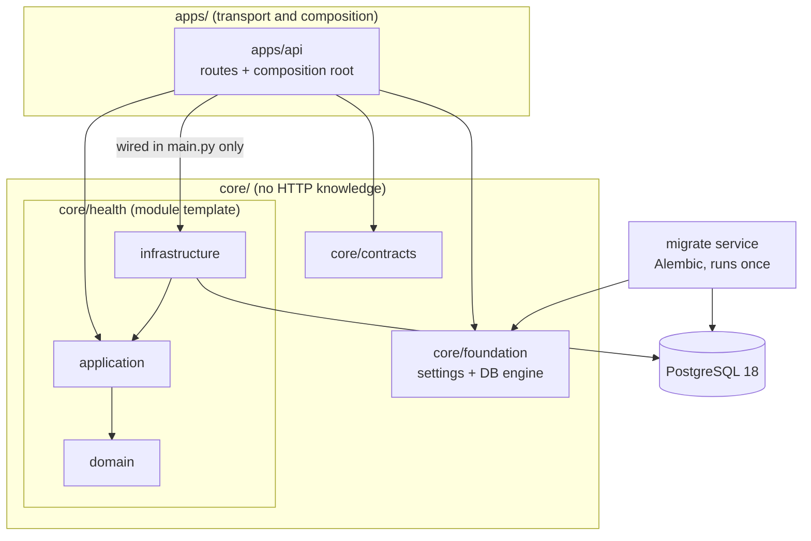

# AI-COS

[](pyproject.toml)
[](compose.yaml)
[](LICENSE)
[](#tests)

**AI-COS: A security-first modular monolith foundation for orchestrating autonomous AI agents and complex workflows.**

> **Status: Phase 1 foundation.** This repository contains the service skeleton, database security model, migrations and test harness. Agents, workflows and model calls are not implemented yet, and the service is not production-ready. `docs/` specifies the target system, including parts that do not exist yet.

## Quickstart

You need Docker Engine with the Compose plugin. If your user is not in the `docker` group, prefix the `docker` commands with `sudo`.

**1. Clone the repository**

```bash
git clone https://github.com/<atestokhay>/ai-cos.git
cd ai-cos
```

**2. Create `.env` with generated passwords**

```bash
cp .env.example .env && chmod 600 .env
for v in POSTGRES_PASSWORD MIGRATOR_DB_PASSWORD APP_DB_PASSWORD; do
  sed -i "s/^$v=.*/$v=$(openssl rand -hex 32)/" .env
done
```

**3. Start the stack**

```bash
docker compose up -d --build --wait
curl http://127.0.0.1:8000/health/ready    # {"status":"ok"}
```

Stop it with `docker compose down`. **`docker compose down -v` permanently deletes the development database.**

## Why it is built this way

**PostgreSQL least privilege.** The API connects as an `app` role that has no DDL rights: `CREATE TABLE`, `CREATE SCHEMA` and `CREATE TEMP TABLE` are all rejected with SQLSTATE `42501`. Privileges inherited through `PUBLIC` are revoked too, and `app` cannot connect to other databases. Migrations run under a separate, non-superuser `migrator` role, and each Compose service receives only its own credential.

**Layer boundaries enforced by tests.** `import-linter` runs in the test suite, so a boundary violation fails the build instead of waiting for code review:

- `core` cannot import `apps`.
- `domain` and `application` cannot import FastAPI, SQLAlchemy or Psycopg.
- Routes cannot reach `infrastructure`.
- Application code cannot import Alembic.
- A new `core` package fails the check until it is placed in the layering contract.

**A modular monolith instead of premature microservices.** There is one codebase with explicit module boundaries. A service gets split out only for a different trust boundary or a measured scaling need, so the architecture avoids the operational cost of distributed services until there is a reason to pay it.

**A small network surface.** PostgreSQL publishes no host port, the API is published only on `127.0.0.1`, and the API and migration images run as a non-root user. The `runtime` image contains no development dependencies.

## Architecture



| Path | Responsibility |
|---|---|
| `apps/api` | HTTP layer and composition root, the only place infrastructure is wired in |
| `core/foundation` | Settings and database engine; no business logic |
| `core/contracts` | Shared contracts |
| `core/health` | The one vertical slice so far; later modules follow the same layout |
| `migrations` | Alembic environment and an empty baseline revision |
| `docker/postgres/init` | Role and privilege setup, applied when the data volume is first created |
| `scripts` | Acceptance test, license check and secret check |

**Stack:** Python 3.12, FastAPI, Uvicorn, pydantic-settings, SQLAlchemy Core (synchronous), Psycopg 3, Alembic, PostgreSQL 18, Docker Compose. Tests use pytest, httpx and import-linter. Dependencies are locked with uv. The reasoning is in [ADR-0001](docs/adr/0001-phase1-foundation.md).

## Roadmap

- **[Done] Phase 1: Foundation.** Modular monolith skeleton, health endpoints, PostgreSQL roles, migrations, Compose environment, acceptance test.
- **[Upcoming] Phase 2: Agent Engine.**
- **[Upcoming] Phase 3: Web UI.**

### Known limitations

- There is no authentication, and the health endpoints have no rate limit. The specification requires a rate limit on every endpoint, so this gap must be closed before production.
- The data model in [docs/data-model.md](docs/data-model.md) is conceptual; there are no business tables yet.
- No production deployment is defined. The `runtime` image is built and tested, but it is not published.
- There is no CI yet, so the test results below come from local runs.

## Tests

```bash
python3 -m venv .tools/uv && .tools/uv/bin/pip install uv==0.13.6
.tools/uv/bin/uv sync --frozen

.venv/bin/pytest                             # unit tests
.venv/bin/lint-imports --no-cache            # import boundaries
.venv/bin/python scripts/check_licenses.py   # dependency licenses, from installed metadata
scripts/check_secrets.sh                     # pattern-based secret check, not an exhaustive scanner
scripts/verify-phase1.sh                     # end-to-end acceptance test
```

Integration tests run inside the API container, against the real database:

```bash
docker compose exec -T api pytest -q -p no:cacheprovider tests/integration
```

`verify-phase1.sh` checks 37 acceptance criteria in an isolated `aicos-acceptance` Compose project with throwaway secrets. It does not read `.env`, does not touch development volumes and does not start the Docker daemon. It covers:

- role privileges, checked with real statements
- a database outage and recovery
- the migration cycle
- data persistence across restart, recreation and `down`/`up`
- network exposure
- the contents of the runtime image

| Exit code | Meaning |
|---|---|
| `0` | All criteria passed |
| `1` | At least one criterion failed |
| `2` | Nothing failed, but at least one criterion could not be verified |

The badge reflects the last recorded local run on 2026-11-03: 37 of 37 criteria passed.

## Migrations

Migrations run in the `migrate` service as the `migrator` role. The API never runs them.

```bash
docker compose run --rm migrate alembic current
docker compose run --rm migrate alembic upgrade head
docker compose run --rm migrate alembic downgrade -1
```

<details>
<summary>Running the Docker daemon manually with systemd</summary>

To keep the daemon from starting at boot:

```bash
sudo systemctl disable --now docker.service docker.socket containerd.service
systemctl is-enabled docker.service docker.socket containerd.service  # each should print "disabled"

sudo systemctl start docker.service                                   # start
sudo systemctl stop docker.service docker.socket containerd.service   # stop completely
systemctl is-active docker.service docker.socket containerd.service   # status
```

- `docker.service` depends on `docker.socket` and `containerd.service`, so starting it brings up both.
- If only `docker.service` is stopped, `docker.socket` stays active and the next `sudo docker` command restarts the daemon.
- The socket is `root:docker 0660`, so a user outside the `docker` group cannot trigger this without `sudo`.
- The package preset for these units is `enabled`, so re-check `is-enabled` after package upgrades.

</details>

## Documentation

| Document | Contents |
|---|---|
| [docs/architecture-and-requirements.md](docs/architecture-and-requirements.md) | Target architecture, trust boundaries, model routing and requirements |
| [docs/data-model.md](docs/data-model.md) | Conceptual data model and open schema decisions |
| [docs/business-rules.md](docs/business-rules.md) | Workflows, permissions, governance and approval rules |
| [docs/api-spec.md](docs/api-spec.md) | API requirements; most routes and schemas are still undefined |
| [docs/adr/0001-phase1-foundation.md](docs/adr/0001-phase1-foundation.md) | Phase 1 decisions and known gaps |
| [CLAUDE.md](CLAUDE.md) | Working rules for Claude Code, which is used in this project's development |

## License

This project's own code and documentation are under the [MIT License](LICENSE). Third-party dependencies keep their own licenses and are not relicensed by it; `scripts/check_licenses.py` reports them, and [ADR-0001](docs/adr/0001-phase1-foundation.md) records the non-permissive ones.
